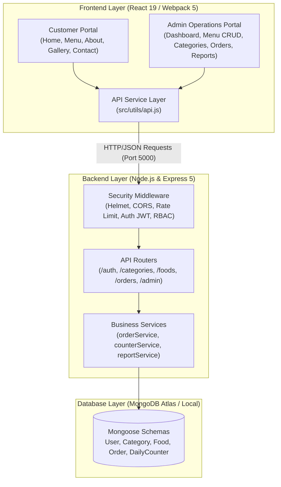

# Hotel New Moorthi Cafe — Full Stack Web Application

> Authentic South Indian Restaurant Web Platform for **Hotel New Moorthi Cafe, Chidambaram**.  
> Features public customer menu exploration, customer authentication, live cart & server-side bill calculation, idempotent counter pickup orders with atomic token allocation, and a dedicated admin operations portal.

---

## 1. Project Overview & Team Structure

| Developer | Role | Quota | Primary Ownership Area |
| :--- | :--- | :---: | :--- |
| **Ragul** | **Team Lead, Integration & Delivery** | **30%** | Repository foundation, API contract coordination, shared integration, QA & security verification, deployment |
| **Rohith** | **Frontend Engineer** | **35%** | React UI, responsive layouts, menu/search, cart/checkout flow, order confirmation, admin UI |
| **Ravi** | **Backend Engineer** | **35%** | Node.js/Express APIs, MongoDB Atlas models, authentication, cart pricing engine, atomic token generator, admin operations |

---

## 2. Full-Stack System Architecture



---

## 3. Frontend Architecture (`src/`)

### 3.1 Technology Stack
- **Framework**: React 19 (`react`, `react-dom`)
- **Routing**: React Router v7 (`react-router-dom`)
- **Bundler & Tooling**: Webpack 5, Webpack Dev Server, Babel
- **Design System**: Vanilla CSS tokens inspired by South Indian heritage:
  - **Warm Ivory** (`#FAF5EF`) — Clean background
  - **Terracotta** (`#C05621`) — Primary brand actions
  - **Banana Leaf** (`#2F855A`) — Pure vegetarian & success accents
  - **Turmeric Gold** (`#D69E2E`) — Ratings & highlights

### 3.2 Directory Structure
```
src/
├── admin/                      # Staff & admin operational screens
│   ├── AddEditFood.js          # Create/edit food items with image and tag support
│   ├── AdminDashboard.js       # Operational metrics, live order counters, and summaries
│   ├── AdminLogin.js           # Secure admin authentication
│   ├── CategoryManagement.js   # Dynamic category CRUD & availability management
│   ├── CustomerManagement.js   # Registered customer roster and engagement
│   ├── MenuManagement.js       # Live menu overview and fast stock toggle
│   └── SalesReports.js         # Daily/monthly revenue charts and item analytics
├── components/                 # Reusable UI components
│   ├── FoodCard.js             # Interactive food card with price, tags, and action
│   ├── Footer.js               # Restaurant hours, address, and legal information
│   └── Navbar.js               # Responsive navigation bar with mobile toggle
├── pages/                      # Customer-facing public pages
│   ├── About.js                # Chidambaram culinary heritage and tradition
│   ├── Contact.js              # Address, operating hours, phone, and inquiry form
│   ├── Gallery.js              # High-definition food & restaurant photo gallery
│   ├── Home.js                 # Hero showcase, signature items, and quick links
│   └── Menu.js                 # Filterable food menu with category selection and search
├── utils/
│   └── api.js                  # Centralized HTTP API client for backend communication
├── App.js                      # Route registry (public + admin)
├── index.css                   # Global stylesheet and CSS design tokens
└── index.js                    # React application entry point
```

### 3.3 Pages & Routing Reference
| URL Path | Component | Audience | Description |
| :--- | :--- | :--- | :--- |
| `/` | `Home.js` | Public | Hero banner, bestsellers, customer testimonials, quick CTAs |
| `/menu` | `Menu.js` | Public | Search, category filters, spice/dietary indicators, FoodCard list |
| `/about` | `About.js` | Public | Restaurant history, firewood cooking, authenticity story |
| `/gallery` | `Gallery.js` | Public | Dish photography, dining ambiance, kitchen craft |
| `/contact` | `Contact.js` | Public | Chidambaram location, counter hours, contact details |
| `/admin/login` | `AdminLogin.js` | Staff | JWT credential login for restaurant managers |
| `/admin/dashboard` | `AdminDashboard.js` | Admin | Real-time sales summary, pending tokens, kitchen alerts |
| `/admin/menu-management` | `MenuManagement.js` | Admin | Menu item list, active/inactive toggles, price updates |
| `/admin/add-edit-food` | `AddEditFood.js` | Admin | Dish authoring (prices, Tamil subtitles, prep time, tags) |
| `/admin/category-management` | `CategoryManagement.js` | Admin | Category creation, editing, item counts, deletion |
| `/admin/customer-management` | `CustomerManagement.js` | Admin | Customer directory, order counts, contact details |
| `/admin/sales-reports` | `SalesReports.js` | Admin | Revenue breakdown, top selling dishes, sales trends |

---

## 4. Backend Architecture (`backend/`)

### 4.1 Technology Stack
- **Runtime**: Node.js (v20+)
- **Server Framework**: Express.js (v5)
- **Database**: MongoDB Atlas or Local MongoDB via Mongoose (v9)
- **Security & Utilities**:
  - `helmet`: Security HTTP headers
  - `cors`: Explicit origin whitelist (`CLIENT_URL`, `localhost:9003`, `localhost:5173`, etc.)
  - `express-rate-limit`: Global abuse prevention (300 req / 15 min window)
  - `bcryptjs`: Password hashing with 10 salt rounds
  - `jsonwebtoken`: Stateless JWT token generation & verification

### 4.2 Core Architectural Principles
1. **Paise-Strict Currency Model**:
   - All food prices and totals are stored and calculated strictly in **integer paise** (`₹80.00 = 8000 paise`).
   - Prevents floating-point rounding errors during pricing and tax computation.
2. **Atomic Daily Pickup Tokens**:
   - Every pickup order receives a daily reset token (e.g. `T-001`, `T-002`) handled by `counterService`.
   - Uses MongoDB's atomic `$inc` on `DailyCounter` scoped to `Asia/Kolkata` date boundaries to prevent collisions under high concurrency.
3. **Idempotent Order Creation**:
   - Order placement requires an `Idempotency-Key` HTTP header.
   - Retried requests return the original order snapshot rather than generating duplicate orders or double tokens.
4. **Role-Based Access Control (RBAC)**:
   - Three privilege tiers: `customer`, `staff`, and `admin`.
   - Staff/admin endpoints strictly verify JWT role claims before processing requests.

### 4.3 Directory Structure
```
backend/
├── docs/                       # Architecture and integration guides
│   ├── API_DOCUMENTATION.md    # Exhaustive endpoint reference
│   ├── DATABASE_SCHEMA.md      # Detailed Mongoose model definitions
│   ├── FRONTEND_INTEGRATION_GUIDE.md # Integration instructions for UI
│   ├── POSTMAN_TESTING_GUIDE.md # Postman test execution steps
│   ├── SECURITY_CHECKLIST.md   # Production hardening checklist
│   └── SETUP_GUIDE.md          # Comprehensive backend setup guide
├── src/
│   ├── config/
│   │   ├── db.js               # MongoDB Mongoose connection handler
│   │   └── env.js              # Environment variable validation & typecasting
│   ├── controllers/
│   │   ├── adminController.js  # Dashboard metrics, orders queue, customer lists
│   │   ├── authController.js   # User registration, login, profile retrieval
│   │   ├── categoryController.js # Category queries & CRUD
│   │   ├── foodController.js   # Menu listing, search, item detail & CRUD
│   │   └── orderController.js  # Cart preview, order placement, order history
│   ├── middleware/
│   │   ├── authenticate.js     # JWT Bearer token validator
│   │   ├── authorize.js        # RBAC role authorization guard
│   │   ├── errorHandler.js     # Standardized JSON error response handler
│   │   ├── notFound.js         # 404 handler for unmatched routes
│   │   ├── optionalAuth.js     # Non-blocking auth for cart calculations
│   │   └── validate.js         # Joi/validator runner middleware
│   ├── models/
│   │   ├── Category.js         # Food category schema with slug
│   │   ├── DailyCounter.js     # Atomic daily sequence counter schema
│   │   ├── Food.js             # Food item schema with paise pricing
│   │   ├── Order.js            # Order lifecycle schema with token & items snapshot
│   │   └── User.js             # User account schema with bcrypt password hashing
│   ├── routes/
│   │   ├── adminRoutes.js      # /api/v1/admin router
│   │   ├── authRoutes.js       # /api/v1/auth router
│   │   ├── categoryRoutes.js   # /api/v1/categories router
│   │   ├── foodRoutes.js       # /api/v1/foods router
│   │   └── orderRoutes.js      # /api/v1/orders router
│   ├── services/
│   │   ├── counterService.js   # Atomic sequence token generator
│   │   ├── orderService.js     # Server-side pricing engine & order creation
│   │   └── reportService.js    # Revenue & order analytics aggregation
│   ├── utils/
│   │   ├── AppError.js         # Custom operational error class
│   │   ├── asyncHandler.js      # Wrapper for async Express route handlers
│   │   ├── dateTime.js         # IST timezone formatting helpers
│   │   ├── generateOrderId.js  # Human-readable order ID builder (NMC-YYYYMMDD-XXXX)
│   │   ├── queryHelpers.js     # Safe regex escape & query sanitation
│   │   └── seedData.js         # Initial database seeding script
│   ├── validators/             # Request payload schemas
│   │   ├── authValidators.js
│   │   ├── categoryValidators.js
│   │   ├── foodValidators.js
│   │   └── orderValidators.js
│   ├── app.js                  # Express application setup
│   └── server.js               # HTTP server listener
└── tests/                      # Automated test suite
    ├── admin.test.js
    ├── auth.test.js
    ├── concurrency_token.test.js
    ├── menu.test.js
    ├── order.test.js
    ├── runAllTests.js          # Master test runner
    ├── security_regression.test.js
    └── testHelper.js
```

---

## 5. API Summary & Contract

All endpoints are hosted under `/api/v1`:

| Group | Method | Endpoint | Access | Purpose |
| :--- | :--- | :--- | :--- | :--- |
| **System** | `GET` | `/health` | Public | System uptime & MongoDB connection health check |
| **Auth** | `POST` | `/auth/register` | Public | Register new customer account |
| **Auth** | `POST` | `/auth/login` | Public | Authenticate via email or 10-digit mobile number |
| **Auth** | `POST` | `/auth/logout` | Public/Auth | Invalidate user session |
| **Auth** | `GET` | `/auth/me` | Authenticated | Fetch authenticated user profile |
| **Categories** | `GET` | `/categories` | Public | List active food categories |
| **Categories** | `POST` | `/categories` | Admin Only | Create new food category |
| **Categories** | `PATCH` | `/categories/:id` | Admin Only | Update category name, description, or availability |
| **Categories** | `DELETE` | `/categories/:id` | Admin Only | Delete food category |
| **Foods** | `GET` | `/foods` | Public | Search food items with category, tag & page filters |
| **Foods** | `GET` | `/foods/:id` | Public | Retrieve single food item details |
| **Foods** | `POST` | `/foods` | Admin Only | Create new menu item |
| **Foods** | `PATCH` | `/foods/:id` | Admin Only | Update existing food item details |
| **Foods** | `DELETE` | `/foods/:id` | Admin Only | Delete food item |
| **Orders** | `POST` | `/orders/validate-cart` | Public/Auth | Server-side cart calculation with subtotal, tax, & packaging |
| **Orders** | `POST` | `/orders` | Authenticated | Place pickup order (`Idempotency-Key` required) |
| **Orders** | `GET` | `/orders/my` | Authenticated | Customer's personal order history |
| **Orders** | `GET` | `/orders/:id` | Authenticated | Retrieve order details & pickup token status |
| **Admin** | `GET` | `/admin/dashboard` | Admin Only | Real-time statistics, today's revenue, active token queue |
| **Admin** | `GET` | `/admin/orders` | Admin Only | Full counter orders list with status filter |
| **Admin** | `PATCH` | `/admin/orders/:id/status` | Admin Only | Progress order through lifecycle stages |
| **Admin** | `GET` | `/admin/reports/sales` | Admin Only | Aggregated sales reports by date range |

For exact JSON request and response shapes, consult [docs/API-CONTRACT.md](docs/API-CONTRACT.md).

---

## 6. Environment Variables Reference

A pre-configured template is provided in `.env.example`. Create a `.env` in the root and in `backend/.env`:

| Variable | Default Value | Scope | Description |
| :--- | :--- | :--- | :--- |
| `PORT` | `5000` | Backend | HTTP server port |
| `NODE_ENV` | `development` | Backend | Application environment (`development` / `production`) |
| `MONGODB_URI` | `mongodb://127.0.0.1:27017/moorthi_cafe` | Backend | MongoDB local connection or Atlas URI |
| `JWT_SECRET` | *(Random 32+ char string)* | Backend | Secret key used to sign JSON Web Tokens |
| `JWT_EXPIRES_IN` | `7d` | Backend | Expiration window for auth tokens |
| `CLIENT_URL` | `http://localhost:9003` | Backend | Allowed CORS origins (comma-separated if multiple) |
| `BUSINESS_TIMEZONE`| `Asia/Kolkata` | Backend | Timezone for token resets and sales counters |
| `BUSINESS_OPEN_TIME`| `06:00` | Backend | Restaurant opening time |
| `BUSINESS_CLOSE_TIME`| `22:30` | Backend | Restaurant closing time |
| `PACKAGING_CHARGE` | `15` | Backend | Standard container/packaging fee (in Rupees) |
| `GST_PERCENTAGE` | `5` | Backend | GST percentage on food and beverage items |

---

## 7. Quick Start & Local Setup

### Step 1: Clone the Repository
```bash
git clone https://github.com/rohith-kanna-jr-2006/moorthi_cafe_webapp.git
cd moorthi_cafe_webapp
```

### Step 2: Configure Environment Files
```bash
# In the repository root
cp .env.example .env

# In the backend directory
cp .env.example backend/.env
```
*(On Windows PowerShell, use `Copy-Item .env.example .env`).*

### Step 3: Backend Setup & Launch
Open terminal 1:
```bash
cd backend
npm install
npm run seed       # Seeds initial authentic South Indian dishes & categories
npm run dev        # Starts server on http://localhost:5000 with nodemon
```
Verify the backend is live by opening:
[http://localhost:5000/api/v1/health](http://localhost:5000/api/v1/health)

### Step 4: Frontend Setup & Launch
Open terminal 2 in the project root:
```bash
npm install
npm start          # Launches Webpack Dev Server on http://localhost:9003
```
Visit **[http://localhost:9003](http://localhost:9003)** to explore the customer application.

---

## 8. Available NPM Scripts

### Frontend Scripts (Root Directory)
| Command | Action |
| :--- | :--- |
| `npm start` | Starts Webpack development server with hot reload on port `9003` |
| `npm run build` | Compiles optimized production bundle into `dist/` |

### Backend Scripts (`backend/` Directory)
| Command | Action |
| :--- | :--- |
| `npm start` | Starts standard Node.js server (`node src/server.js`) |
| `npm run dev` | Starts server with Nodemon auto-reloading |
| `npm run seed` | Seeds default categories and authentic dishes into MongoDB |
| `npm test` | Runs the automated test runner across all test suites |

---

## 9. Automated Testing & Verification

The backend includes a comprehensive suite of **34+ automated tests** verifying business logic, security constraints, and database integrity:

```bash
cd backend
npm test
```

### Test Suites Included:
- **Authentication (`tests/auth.test.js`)**: Registration validation, duplicate user checks, password hashing, valid/invalid logins, token issuance.
- **Menu & Catalog (`tests/menu.test.js`)**: Category creation, food listings, search queries, pagination, and soft availability toggles.
- **Order Calculation (`tests/order.test.js`)**: Server-side paise price computation, GST calculation, packaging charges, and order detail retrieval.
- **Concurrency & Token Sequencing (`tests/concurrency_token.test.js`)**: Verifies atomic daily pickup token generation without duplicates under concurrent requests.
- **Security Regression (`tests/security_regression.test.js`)**: Tests NoSQL query injection prevention, ReDoS regex escaping, rate-limiting, and RBAC authorization barriers.

---

## 10. Git Collaboration & Standards

### 10.1 Branch Conventions
- `feature/<feature-name>`: New feature work (e.g. `feature/food-category-api`, `feature/cart-checkout-ui`)
- `fix/<bug-name>`: Bug fixes and performance adjustments
- `docs/<doc-name>`: Documentation additions and corrections

### 10.2 Workflow Best Practices
1. **Always pull before pushing**:
   ```bash
   git pull --rebase origin main
   ```
2. **Never commit secrets**: Check `.gitignore` before running `git add .`.
3. **Commit Messages**: Use semantic commit prefixes (`feat:`, `fix:`, `refactor:`, `docs:`, `test:`).
4. **Pull Requests**: Changes to `main` must be merged via reviewed Pull Requests with passing tests.

---

## 11. Project Documentation Index

- [Common Project Instructions](docs/COMMON-PROJECT-INSTRUCTIONS.md) — Master instructions, scope, and team boundaries.
- [Shared API Contract](docs/API-CONTRACT.md) — Detailed payload specs, field types, and error shapes.
- [Ragul's Individual Tasks](docs/RAGUL-INDIVIDUAL-TASKS.md) — Phase-by-phase deliverables for Team Lead & Integration.
- [Owner Decisions Log](docs/OWNER-DECISIONS.md) — Status log of all 14 restaurant business decision points and MVP defaults.
- [Backend API Documentation](backend/docs/API_DOCUMENTATION.md) — Detailed backend route reference and headers.
- [Database Schema Guide](backend/docs/DATABASE_SCHEMA.md) — Complete Mongoose schema documentation and data types.
- [Frontend Integration Guide](backend/docs/FRONTEND_INTEGRATION_GUIDE.md) — Best practices for consuming backend APIs in the frontend.
- [Security Checklist](backend/docs/SECURITY_CHECKLIST.md) — Production readiness and security hardening checklist.
- [Backend Setup Guide](backend/docs/SETUP_GUIDE.md) — Step-by-step developer environment setup.
