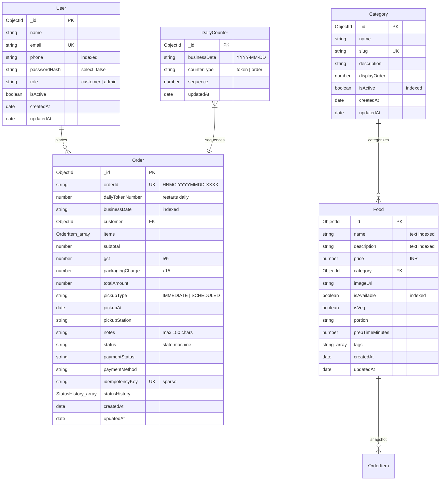
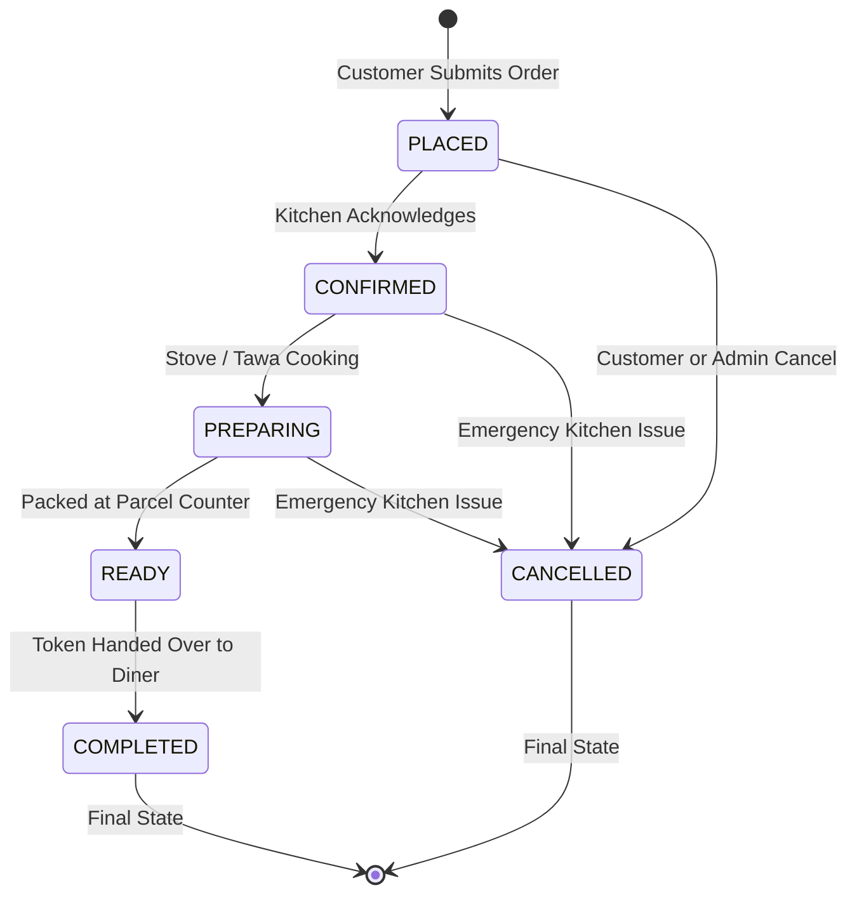

# Hotel New Moorthi Cafe — Database Schema & Architecture

**Database Engine**: MongoDB 8 (Docker container `moorthi-mongodb`)  
**ORM / ODM**: Mongoose 9.x  
**Connection**: `mongodb://127.0.0.1:27017/moorthi_cafe`  
**Timezone Rule**: Timestamps stored in UTC ISO 8601; Business logic calculated in `Asia/Kolkata` (UTC+05:30).

---

## 1. Entity-Relationship Diagram

---

## 2. Order State Machine Transition Matrix

---

## 3. Detailed Collection Specifications

### A. Collection: `users`
| Field | Type | Required | Constraints / Defaults | Description |
| :--- | :--- | :--- | :--- | :--- |
| `_id` | ObjectId | Yes | Auto-generated PK | User identifier |
| `name` | String | Yes | Trimmed, 2–60 chars | Customer full name |
| `email` | String | Yes | Unique, lowercase, regex match | Primary account email |
| `phone` | String | Yes | Trimmed, indexed | Mobile number for SMS token slips |
| `passwordHash` | String | Yes | `select: false` | Bcrypt hashed secret (10 rounds) |
| `role` | String | Yes | Enum `['customer', 'admin']`, default `'customer'` | Privilege level |
| `isActive` | Boolean | Yes | Default `true` | Account active status |
| `createdAt` | Date | Auto | ISO 8601 | Account creation timestamp |
| `updatedAt` | Date | Auto | ISO 8601 | Last updated timestamp |

**Indexes**:
- Unique Index: `{ email: 1 }`
- Secondary Index: `{ phone: 1 }`

---

### B. Collection: `categories`
| Field | Type | Required | Constraints / Defaults | Description |
| :--- | :--- | :--- | :--- | :--- |
| `_id` | ObjectId | Yes | Auto-generated PK | Category identifier |
| `name` | String | Yes | Trimmed, max 60 chars | Category display title |
| `slug` | String | Yes | Unique, lowercase, slugified | Clean URL identifier |
| `description` | String | No | Max 200 chars | Explanatory note for diners |
| `displayOrder` | Number | No | Default `0` | Sort sequence on menu UI |
| `isActive` | Boolean | Yes | Default `true` | Soft-deactivation flag |

**Indexes**:
- Unique Index: `{ slug: 1 }`
- Compound Index: `{ slug: 1, isActive: 1 }`

---

### C. Collection: `foods`
| Field | Type | Required | Constraints / Defaults | Description |
| :--- | :--- | :--- | :--- | :--- |
| `_id` | ObjectId | Yes | Auto-generated PK | Food item identifier |
| `name` | String | Yes | Trimmed, max 100 chars | Dish name |
| `description` | String | No | Trimmed, max 500 chars | Heritage recipe story / details |
| `price` | Number | Yes | Min 0, rounded to 2 decimals | Authoritative price in INR |
| `category` | ObjectId | Yes | Ref: `Category` | Category relationship |
| `imageUrl` | String | No | Default `""` | CDN image URL |
| `isAvailable` | Boolean | Yes | Default `true` | Kitchen live stock toggle |
| `isVeg` | Boolean | Yes | Default `true` | Satvik pure veg guarantee |
| `portion` | String | No | Default `'Standard Serving'` | Serving unit (e.g. 2 Pcs, Cone) |
| `prepTimeMinutes` | Number | Yes | Default `15`, min 1 | Estimated preparation time |
| `tags` | Array<String> | No | e.g. `['chef-special']` | Filter chip badges |

**Indexes**:
- Text Search Index: `{ name: "text", description: "text" }`
- Compound Index: `{ category: 1, isAvailable: 1 }`

---

### D. Collection: `dailycounters`
| Field | Type | Required | Constraints / Defaults | Description |
| :--- | :--- | :--- | :--- | :--- |
| `_id` | ObjectId | Yes | Auto-generated PK | Counter identifier |
| `businessDate` | String | Yes | `YYYY-MM-DD` Asia/Kolkata | Calendar date in IST |
| `counterType` | String | Yes | Enum `['token', 'order']` | Counter type identifier |
| `sequence` | Number | Yes | Default `0` | Atomic increment counter |

**Indexes**:
- Unique Compound Index: `{ businessDate: 1, counterType: 1 }` (Guarantees atomic daily restart)

---

### E. Collection: `orders`
| Field | Type | Required | Constraints / Defaults | Description |
| :--- | :--- | :--- | :--- | :--- |
| `_id` | ObjectId | Yes | Auto-generated PK | Internal MongoDB identifier |
| `orderId` | String | Yes | Unique, format `HNMC-YYYYMMDD-XXXX` | Human-readable order code |
| `dailyTokenNumber` | Number | Yes | Integer (1..N restarts daily) | Physical counter token number |
| `businessDate` | String | Yes | `YYYY-MM-DD` in Asia/Kolkata | Business date for reporting |
| `customer` | ObjectId | Yes | Ref: `User` | Placing customer account |
| `items` | Array<Subdoc> | Yes | Min length 1 | Itemized tiffin snapshot |
| `subtotal` | Number | Yes | Sum of line totals | Authoritative dish subtotal |
| `gst` | Number | Yes | 5% statutory tax | GST on food services |
| `packagingCharge` | Number | Yes | Flat ₹15.00 | Eco plantain leaf packing |
| `totalAmount` | Number | Yes | `subtotal + gst + packaging` | Grand payable total |
| `pickupType` | String | Yes | Enum `['IMMEDIATE', 'SCHEDULED']` | Preparation mode |
| `pickupAt` | Date | Yes | Validated future date | Handover target time |
| `pickupStation` | String | Yes | Default counter name | Counter location |
| `notes` | String | No | Max 150 chars | Kitchen preparation note |
| `status` | String | Yes | Enum (6 states) | Lifecycle state |
| `paymentStatus` | String | Yes | Enum `['PENDING', 'PAID']` | Payment clearance |
| `paymentMethod` | String | Yes | Enum `['UPI', 'COUNTER_CASH', 'CARD']` | Tender type |
| `idempotencyKey` | String | No | Sparse, unique | Client deduplication key |
| `statusHistory` | Array<Subdoc> | Yes | Array of status changes | Audit trail with timestamps |

**Indexes**:
- Unique Index: `{ orderId: 1 }`
- Unique Sparse Index: `{ idempotencyKey: 1 }`
- Compound Index: `{ businessDate: 1, status: 1 }`
- Compound Index: `{ customer: 1, createdAt: -1 }`
